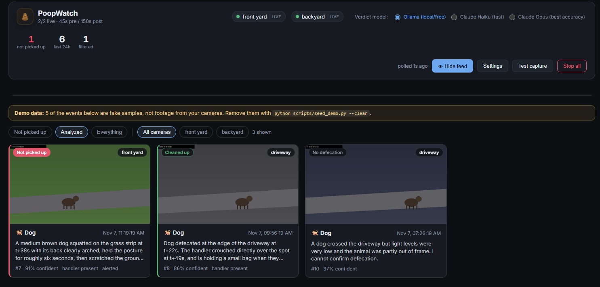

# PoopWatch

Watches a Reolink camera feed and works out whether a dog defecated on your
property — and whether whoever was walking it picked the mess up.



It is built as a funnel, because running a vision model on 24/7 footage is both
slow and expensive. Each stage only passes survivors to the next:

| Stage | What it does | Cost |
|---|---|---|
| 0. Camera AI | Reolink's own on-device `dog_cat` detector fires | free |
| 1. Local detector | YOLO11 confirms a dog is actually in frame *(optional)* | free |
| 2. Gate | A local VLM screens the frames for a squatting posture | free via Ollama |
| 3. Verdict | Claude judges defecation, handler presence, and cleanup | only on gate hits |

In practice the camera's own detector eliminates almost everything, the gate
eliminates the dogs that were merely sniffing, and the paid stage runs a handful
of times a day at most. Set `VERDICT_MODEL=ollama` to run it entirely free.

## Cameras

Configure as many as you like. Each entry is a host + channel pair, which covers
both common setups:

```ini
# two standalone cameras -- different hosts
CAMERA_1_NAME=front yard
CAMERA_1_HOST=192.168.1.50
CAMERA_2_NAME=driveway
CAMERA_2_HOST=192.168.1.51

# or two channels on one NVR -- same host
CAMERA_2_NAME=side gate
CAMERA_2_HOST=192.168.1.50
CAMERA_2_CHANNEL=1
```

Credentials fall back to the shared `REOLINK_USER` / `REOLINK_PASSWORD`, so an
NVR only needs them stated once. The camera numbers are discovered from the
environment rather than scanned up to a fixed limit, so there is no cap and the
numbers need not be contiguous.

Each camera runs its own recorder, poll loop, and cooldown, so one camera going
offline retries on its own without stalling the others.

### Keeping a slow machine healthy

Every camera adds a continuously running ffmpeg process plus its share of disk.
Three levers, in the order worth reaching for:

1. **Turn a camera off from the dashboard.** Each camera is a pill in the header
   — click it to stop or start that one camera. Stopping it kills its ffmpeg
   process and disk writes immediately, and the others keep running.
2. **`MAX_CONCURRENT_ANALYSES`** (default 2) caps how many events may be
   analyzed at once *across all cameras*, so simultaneous triggers queue instead
   of fighting over the GPU. Capture is deliberately outside that limit — it is
   mostly just waiting out the post-roll window.
3. **`REOLINK_STREAM=sub`** and a shorter `SEGMENT_RETENTION_MINUTES` cut disk
   and bandwidth sharply, at some cost in image detail.

Rolling-buffer disk use is roughly `cameras x retention x bitrate`.

## Why a rolling buffer

Dogs squat briefly, and a camera's motion detector often fires *after* the fact.
PoopWatch continuously stream-copies the camera into 10-second segments (no
re-encoding, so effectively 0% CPU) and treats an event as a *time range* into
that ring buffer. That gives it 30 seconds of footage from **before** the
trigger, which is usually where the evidence actually is.

## Requirements

- Python 3.11+ (tested on 3.14)
- ffmpeg — `winget install Gyan.FFmpeg`
- Node 20+ (only to build the dashboard)
- A Reolink camera or NVR reachable on your network, with RTSP enabled
- [Ollama](https://ollama.com) for the free local gate, or an Anthropic API key

## Setup

```bash
python -m venv .venv
.venv\Scripts\pip install -r requirements.txt

# free local gate
ollama pull qwen2.5vl:7b

# the dashboard
cd web && npm install && npm run build && cd ..

```

Camera addresses, passwords, and alert settings are entered in the dashboard's
**Settings** panel, so you don't need a `.env` file. Copy `.env.example` to
`.env` only if you want Claude as the verdict model, which needs
`ANTHROPIC_API_KEY`.

Check everything before you rely on it:

```bash
.venv\Scripts\python -m poopwatch probe
.venv\Scripts\python -m poopwatch probe --camera driveway   # just one
.venv\Scripts\python -m poopwatch probe --skip-rtsp         # skip the slow check
```

`probe` verifies ffmpeg, the gate backend, your alert channels, and then every
camera in turn — API reachability, whether that model supports animal AI
detection, snapshots, and RTSP — and tells you which piece is the broken one.

## Running

```bash
.venv\Scripts\python -m poopwatch serve      # dashboard + watcher
.venv\Scripts\python -m poopwatch watch      # headless
.venv\Scripts\python -m poopwatch replay FILE.mp4   # classify existing footage
```

The dashboard is at <http://127.0.0.1:8420>. `replay` is the fastest way to tune
the prompts: point it at a clip you already have and see what the model says, no
camera or waiting involved.

For UI development, `cd web && npm run dev` serves on :5173 and proxies data
to the Python backend.

### Starting it on Windows

`start-poopwatch.bat` in the project folder starts the server in a minimized
window and opens the dashboard in your browser. Double-click it to start the
app by hand.

To start it automatically when you log in, put a shortcut to the launcher in
your Startup folder. Press `Win+R`, type `shell:startup`, and create a shortcut
there that points to `start-poopwatch.bat` in the project folder. Startup
shortcuts run at login, which is what you want: camera passwords live in your
Windows account's credential store, which only exists once you're logged in.

To stop the automatic start, delete that shortcut from the Startup folder.

To restart after changing code, double-click `restart-poopwatch.bat`. It stops
any running copy of the server, then starts it again. Don't run
`start-poopwatch.bat` while the server is still running: the second copy can't
bind port 8420.

### Dashboard password

By default the dashboard is reachable only from this computer. To open it from
other devices on your home network:

1. Set a password. It's stored in your OS credential store, not in the project:
   ```
   .venv\Scripts\python -m poopwatch set-password
   ```
2. Set `HOST=0.0.0.0` in `.env`. `serve` refuses to listen on the network until
   a password is set.
3. Restart the server. Browsers ask for a login. The username is `poopwatch`,
   and the password is the one you set.

To go back to local-only, run `.venv\Scripts\python -m poopwatch clear-password`
and set `HOST` back to `127.0.0.1`.

The password is sent over plain HTTP, so on a shared Wi-Fi network someone
could read it. For encryption, put the dashboard behind Tailscale or a reverse
proxy such as Caddy.

Analysis needs Ollama running. The Ollama installer adds a Startup shortcut, so
it starts at login. Delete the `Ollama.lnk` shortcut from `shell:startup` if you
don't want that.

## The dashboard

Events are cards with a thumbnail and a verdict badge — red for *not picked up*,
green for *cleaned up*, muted for the ones a cheap stage filtered out. Each card
is tagged with the camera it came from. Opening one gives you the clip, a
scrubbable frame strip, the model's reasoning, and buttons to mark it correct, a
false positive, or handled.

To remove an event, open it and click **Delete event** in the "Danger zone"
section at the bottom. This deletes its database row and its clip, frames, and
thumbnail. It can't be undone.

The header carries one pill per camera: a green dot means healthy, and clicking
it stops or starts that camera on its own. With more than one camera configured,
the filter row also gains a per-camera filter.

Filtered events are kept deliberately: they are the cheapest way to see what the
funnel is throwing away, and whether it's throwing away too much.

## Configuration

Most settings are edited in the dashboard's **Settings** panel. Camera and alert
settings are saved in `evidence/poopwatch.db`, and passwords go to the operating
system's credential store (Windows Credential Manager, macOS Keychain, or Secret
Service on Linux). `.env` is optional and overrides the saved settings. See
`.env.example` for the full annotated list. The settings worth knowing:

| Setting | Default | Notes |
|---|---|---|
| `PRE_ROLL_SECONDS` | 30 | Footage kept from before the trigger |
| `POST_ROLL_SECONDS` | 120 | How long to watch for cleanup afterwards |
| `GATE_BACKEND` | `ollama` | `ollama` (free), `haiku` (~$0.001/event), `off` |
| `VERDICT_MODEL` | `claude-opus-5` | Set to `ollama` to run fully free |
| `DISABLE_LOCAL_DETECTOR` | `false` | Skip stage 1 even if ultralytics is installed |
| `MAX_CONCURRENT_ANALYSES` | 2 | Concurrent analyses across all cameras |

The optional free local detector needs `pip install -r requirements-local.txt`
(this pulls in torch, ~2GB). Without it, stage 1 is simply skipped.

## Running costs

Ollama runs the gate and verdict for free. If you switch either stage to Claude,
you pay Anthropic per token. These are list prices per million tokens, checked
2026-11-07:

| Model | Input | Output |
|---|---|---|
| Claude Haiku 5.5 (prompts up to 100K tokens) | $0.10 | $0.50 |
| Claude Opus 5.5 | $4.00 | $20.00 |

Images are billed as input tokens: each image costs about
`ceil(width / 28) × ceil(height / 28)` tokens. Your 1280×960 camera frames are
about 1,610 tokens each. A verdict sends 16 frames, and the gate sends 6.

Estimated cost per event at that resolution:

| Stage | Haiku 5.5 | Opus 5.5 |
|---|---|---|
| Gate (6 frames) | under $0.001 | about $0.05 |
| Verdict (16 frames) | about $0.003 | about $0.13 |

These are estimates. Actual cost depends on the number of frames, the output
length, and how often the gate passes. Check the
[current pricing page](https://platform.claude.com/docs/en/about-claude/pricing)
before you rely on these numbers.

## Alerts

Two independent channels, both optional, neither able to break the other:

- **ntfy** — set `NTFY_TOPIC` to something unguessable and subscribe to it in
  the [ntfy](https://ntfy.sh) app. The snapshot is attached to the push.
- **Email** — standard SMTP. For Gmail you need an app password, not your
  account password.

Alerts fire only on a genuine violation: subject is a dog, defecation was
observed, and cleanup was not. That rule is computed in code
(`Verdict.is_violation`), not left to the model, so it can't drift.

## Accuracy, honestly

This is a camera pointed at a yard, not a courtroom exhibit.

- The verdict model is deliberately conservative and will report
  `defecation_occurred=false` when the footage is dark, distant, or obstructed.
  Expect misses before expect false alarms.
- "Did they pick it up" is the hardest judgment in the system. A handler who
  bags the mess just outside the frame, or after the post-roll window closes,
  will read as a violation. Lengthen `POST_ROLL_SECONDS` if you see that.
- A 7B local model is a decent gate but noticeably weaker at the temporal
  reasoning the verdict needs. Running stage 3 on Ollama costs nothing and will
  be meaningfully less reliable.
- Use the false-positive button. Those labels are what you tune against.

## Privacy

This records video of a public-facing area, which may include people who have
not consented to being filmed and analyzed. A few things follow from that:

- **`evidence/` is gitignored and must stay that way.** It holds raw footage,
  extracted frames, and the SQLite log. None of it belongs in a public repo.
- `.env` is gitignored; only `.env.example` with placeholders is committed.
- Camera credentials are scrubbed from ffmpeg error output before it is logged
  or served, because ffmpeg echoes the RTSP URL — password included — in most
  of its error messages, and the dashboard displays those.
- The server binds to `127.0.0.1` by default, so only this machine can reach it.
  To open it on your home network, set a dashboard password first (see
  "Dashboard password" below). Don't expose it to the internet.
- Frames of your camera's view are sent to the Anthropic API when stage 3 runs.
  Set `VERDICT_MODEL=ollama` if you would rather nothing left the machine.
- Camera recording laws vary by jurisdiction, particularly where audio or a
  neighbour's property is in frame. Worth a look before you point it anywhere.

## Layout

```
poopwatch/
  config.py     settings from .env
  reolink.py    camera HTTP API (AI state, snapshots), one client per camera
  capture.py    rolling segment recorder, clip assembly, frame extraction
  detector.py   optional free YOLO stage
  vision.py     Ollama + Claude backends behind one interface
  analyze.py    the schemas and prompts for the gate and the verdict
  pipeline.py   the funnel
  watcher.py    one poll loop per camera, plus the pool that owns them
  server.py     FastAPI backend
  store.py      SQLite event log
  notify.py     ntfy + email
web/            React dashboard (Vite)
```

## License

MIT
